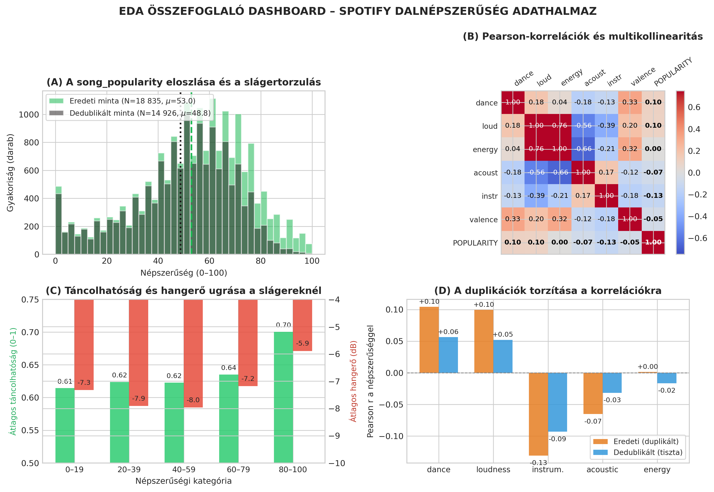

---
puppeteer:
  preferCSSPageSize: true
  displayHeaderFooter: false
  margin:
    top: 10mm
    bottom: 10mm
    left: 11mm
    right: 11mm
---

<style>
  @page {
    size: A4 portrait !important;
    margin: 10mm 11mm 10mm 11mm !important;
  }
  html, body, .markdown-preview, .markdown-preview.markdown-preview {
    font-family: -apple-system, BlinkMacSystemFont, "Segoe UI", Roboto, Helvetica, Arial, sans-serif !important;
    font-size: 10pt !important;
    line-height: 1.4 !important;
    color: #1f2328 !important;
    padding: 0 !important;
    margin: 0 !important;
    background-color: #ffffff !important;
  }
  h1, .markdown-preview h1 {
    font-size: 15.5pt !important;
    margin: 0 0 5px 0 !important;
    color: #0f172a !important;
    text-align: center !important;
    font-weight: 700 !important;
  }
  h2, .markdown-preview h2 {
    font-size: 12pt !important;
    margin: 7px 0 4px 0 !important;
    color: #1e3a8a !important;
    border-bottom: 1.2px solid #cbd5e1 !important;
    padding-bottom: 2px !important;
    font-weight: 700 !important;
  }
  h3, .markdown-preview h3 {
    font-size: 10.5pt !important;
    margin: 6px 0 3px 0 !important;
    color: #334155 !important;
    font-weight: 700 !important;
  }
  table, .markdown-preview table {
    width: 100% !important;
    border-collapse: collapse !important;
    font-size: 8.8pt !important;
    margin: 5px 0 7px 0 !important;
  }
  th, td, .markdown-preview th, .markdown-preview td {
    border: 0.8px solid #cbd5e1 !important;
    padding: 4.0px 5.5px !important;
    text-align: left !important;
  }
  th, .markdown-preview th {
    background-color: #f1f5f9 !important;
    color: #0f172a !important;
    font-weight: 600 !important;
  }
  tr:nth-child(even) td {
    background-color: #f8fafc !important;
  }
  ul, ol, .markdown-preview ul, .markdown-preview ol {
    margin: 3px 0 5px 0 !important;
    padding-left: 20px !important;
  }
  li, .markdown-preview li {
    margin-bottom: 2.5px !important;
    line-height: 1.38 !important;
  }
  p, .markdown-preview p {
    margin: 3px 0 4px 0 !important;
  }
  img, .markdown-preview img {
    max-height: 275px !important;
    width: auto !important;
    max-width: 98% !important;
    display: block !important;
    margin: 3px auto 5px auto !important;
  }
  .header-box {
    background-color: #f8fafc !important;
    border: 1px solid #cbd5e1 !important;
    border-radius: 4px !important;
    padding: 5px 12px !important;
    margin-bottom: 6px !important;
    font-size: 9.2pt !important;
    text-align: center !important;
  }
  .formula-box {
    background-color: #f1f5f9 !important;
    border-left: 3.5px solid #2563eb !important;
    padding: 6px 14px !important;
    margin: 6px 0 !important;
    font-size: 9.6pt !important;
    font-weight: 600 !important;
    text-align: center !important;
  }
  pre, code, .markdown-preview pre, .markdown-preview code {
    font-family: ui-monospace, SFMono-Regular, "SF Mono", Menlo, Consolas, monospace !important;
    font-size: 8.2pt !important;
    padding: 1.5px 3.5px !important;
    margin: 1px 0 !important;
    line-height: 1.24 !important;
  }
  pre {
    background-color: #f8fafc !important;
    border: 0.8px solid #cbd5e1 !important;
    border-radius: 3px !important;
    padding: 6px 8px !important;
  }
  .page-break, .pagebreak, div.page-break {
    page-break-after: always !important;
    break-after: page !important;
    height: 0 !important;
    margin: 0 !important;
    padding: 0 !important;
  }
</style>

<!-- ========================================================================================= -->
<!-- 1. OLDAL: A FELADAT MEGHATÁROZÁSA ÉS AZ ADATBÁZIS ÁTTEKINTÉSE -->
<!-- ========================================================================================= -->

# Gépi Tanulás – 1. Mérföldkő Dokumentáció

### 1.1. A Feladat típusának meghatározása: regresszió
A projekt célja zenei művek streaming-népszerűségének automatikus előrejelzése akusztikai és zenei jellemzőik alapján.

* **Célváltozó:** `song_popularity` (egész számok a [0, 100] zárt intervallumon).
* **Feladat típusa:** **Felügyelt tanulás – Regresszió (Supervised Regression)**.

**Szakmai Indoklás (Miért regresszió és miért nem osztályozás?):**

1. **Folytonos skála:** Bár a tárolt érték diszkrét egész pontszám, konceptuálisan folytonos intenzitási mutató (a lejátszási gyakoriságok és a dalfrissesség normalizált arányszáma a Spotify streaming-motorjában).
2. **Kvantitatív hibaértelmezés:** A predikció hibájának arányosnak kell lennie az eltérés mértékével. Ha a valós népszerűség 80, a 78-as becslés marginális eltérés, míg a 20-as súlyos modellhiba. Osztályozásnál e távolsági rangsor teljesen elveszne.
3. **Információvesztés elkerülése:** Bár létrehozható lenne bináris kategória (pl. ≥ 65 → *Sláger*), ez mesterséges diszkretizációt képezne, és a döntési határvonal mentén (pl. 64 vs. 65 pont) indokolatlan hibaugrást eredményezne. Emiatt a feladatot egyértelműen **regressziós feladatként** definiáljuk.

### 1.2. Az adatbázis forrása és méretei

* **Adatforrás:** Kaggle – *Song Popularity Dataset* (CC0 Public Domain), közvetlenül a **Spotify Web API** (`/v1/audio-features` és `/v1/tracks`) lekérdezéseiből összeállítva.
* **Méret és teljesség:** **18 835 megfigyelés (sor)** és **15 attribútum (oszlop)**; **0 db hiányzó érték** (100.0% épség); **13 070 egyedi dalcím**.
* **Duplikációk:** **3 909 teljes duplikált sor (20.75%)**, melyek eltávolítása után **14 926 egyedi rekord** marad az elemzéshez.
* **Célváltozó statisztikái:** Átlag: **52.99**, Medián: **56.00**, Szórás: **21.91**, Min: **0**, Max: **100**.

### 1.3. A numerikus változók leíró statisztikai összefoglalója

| Jellemző | Típus | Min | Q25 | Medián | Q75 | Max | Átlag (μ) | Szórás (σ) |
| :--- | :---: | :---: | :---: | :---: | :---: | :---: | :---: | :---: |
| `song_popularity` | int64 | 0 | 40.0 | 56.0 | 69.0 | 100 | 52.99 | 21.91 |
| `song_duration_ms` | int64 | 12 000 | 184 340 | 211 306 | 242 844 | 1 799 346 | 218 212 | 59 888 |
| `acousticness` | float64 | 0.0000 | 0.0241 | 0.1320 | 0.4240 | 0.9960 | 0.2585 | 0.2887 |
| `danceability` | float64 | 0.0000 | 0.5330 | 0.6450 | 0.7480 | 0.9870 | 0.6333 | 0.1567 |
| `energy` | float64 | 0.0011 | 0.5100 | 0.6740 | 0.8150 | 0.9990 | 0.6450 | 0.2141 |
| `instrumentalness`| float64 | 0.0000 | 0.0000 | 0.00001| 0.0026 | 0.9970 | 0.0780 | 0.2216 |
| `key` | int64 | 0 | 2.0 | 5.0 | 8.0 | 11 | 5.29 | 3.61 |
| `liveness` | float64 | 0.0109 | 0.0929 | 0.1220 | 0.2210 | 0.9860 | 0.1796 | 0.1440 |
| `loudness` | float64 | -38.77 | -9.04 | -6.55 | -4.91 | +1.58 | -7.45 | 3.83 |
| `audio_mode` | int64 | 0 | 0.0 | 1.0 | 1.0 | 1 | 0.63 | 0.48 |
| `speechiness` | float64 | 0.0000 | 0.0378 | 0.0555 | 0.1190 | 0.9410 | 0.1021 | 0.1044 |
| `tempo` | float64 | 0.0000 | 98.37 | 120.01 | 139.93 | 242.32 | 121.07 | 28.71 |
| `time_signature` | int64 | 0 | 4.0 | 4.0 | 4.0 | 5 | 3.96 | 0.30 |
| `audio_valence` | float64 | 0.0000 | 0.3350 | 0.5270 | 0.7250 | 0.9840 | 0.5280 | 0.2446 |

<div class="page-break"></div>

<!-- ========================================================================================= -->
<!-- 2. OLDAL: A JELLEMZŐK RÉSZLETES BEMUTATÁSA ÉS ZENEI MEGFELELŐI -->
<!-- ========================================================================================= -->

## A jellemzők (Audio Features) részletes ismertetése

### 2.1. A változók katalógusa és technikai értelmezése

| Jellemző | Típus és Skála | Mérnöki / Zenei Jelentés és Eloszlási Sajátosság |
| :--- | :---: | :--- |
| **`song_name`** | String | A dal címe a metaadatokból. Nem egyedi azonosító (13 070 egyedi cím / 18 835 sor). |
| **`song_popularity`** | int [0, 100] | Célváltozó. Streamelésszám és időbeli frissesség normalizált kombinációja. |
| **`song_duration_ms`**| int (ms) | Időtartam ms-ban. Medián: 3.5 perc (211 306 ms). Extrém tartomány: 12 mp – 30 perc. |
| **`acousticness`** | float [0.0, 1.0] | Annak valószínűsége, hogy a felvétel tisztán akusztikus hangszerekkel készült. |
| **`danceability`** | float [0.0, 1.0] | Táncolhatóság tempóstabilitás, ritmusszabályosság és beat-erősség alapján. |
| **`energy`** | float [0.0, 1.0] | Észlelt dinamizmus és intenzitás. A gyors, hangos és sűrű dalok értéke magas. |
| **`instrumentalness`**| float [0.0, 1.0] | Annak esélye, hogy nincs énekhang (erősen jobbra ferde: a dalok 75%-ánál ≤ 0.0026). |
| **`key`** | int [0, 11] | Alaphangnem a Pitch Class kódolás szerint (0 = C, 1 = C♯/D♭, ..., 11 = B). |
| **`liveness`** | float [0.0, 1.0] | Közönségzaj érzékelése; 0.8 felett szinte biztosan élő koncertfelvétel. |
| **`loudness`** | float (dB) | Átlagos integrált hangerő decibelben. Jellemző sáv: -38.8 dB és +1.58 dB között. |
| **`audio_mode`** | int {0, 1} | Modalitás: 1 = Dúr (Major, 62.8%), 0 = Moll (Minor, 37.2%). |
| **`speechiness`** | float [0.0, 1.0] | Kimondott szavak aránya (> 0.66: beszéd/podcast, 0.33–0.66: rap, < 0.33: zene). |
| **`tempo`** | float (BPM) | Becsült ritmustempó percenkénti leütésszámban. Átlag: 121.1 BPM. |
| **`time_signature`**| int [0, 5] | Ütemmutató. Erősen 4/4 domináns (94.26%), ritka a 3/4 (4.10%) és az 5/4 (1.24%). |
| **`audio_valence`** | float [0.0, 1.0] | Zenei hangulat és pozitivitás (1.0 = vidám/euforikus; 0.0 = melankolikus/szomorú). |

### 2.2. Változók közötti erős korrelációk és multikollinearitás

A jellemzők páronkénti Pearson-korrelációs vizsgálata markáns interakciókat tár fel az akusztikai változók között:

* **`energy` ↔ `loudness` (r = +0.7555):** Kifejezetten erős pozitív kapcsolat. A hangosabbra masterelt dalokat a jelfeldolgozó algoritmus egyúttal szignifikánsan energikusabbnak minősíti.
* **`acousticness` ↔ `energy` (r = -0.6626):** Markáns negatív összefüggés. Az akusztikus művek spektrális sűrűsége és dinamikai energiája jóval alacsonyabb a modern produkcióknál.
* **`acousticness` ↔ `loudness` (r = -0.5577):** Az akusztikus darabok átlagos hangereje jelentősen elmarad a modern többsávos stúdiópopétól.
* **`danceability` ↔ `audio_valence` (r = +0.3320):** A ritmikusabb, táncolhatóbb felvételek hajlamosabbak pozitívabb érzelmi tónust hordozni.

**Modellezési konzekvencia:** A standard lineáris regresszió (OLS) bizonytalanná és instabillá válhat az `energy` és `loudness` közötti erős multikollinearitás miatt.

<div class="page-break"></div>

<!-- ========================================================================================= -->
<!-- 3. OLDAL: ADATMINŐSÉG, DUPLIKÁCIÓK ÉS ANOMÁLIÁK AUDITJA -->
<!-- ========================================================================================= -->

## Adatminőség-felmérés és anomália-audit

### 3.1. Hiányzó értékek auditja: teljes épség
Az adatbázis teljességének vizsgálata megállapította, hogy a táblázatban **egyetlen hiányzó érték (NaN / Null) sem található**:

<div class="formula-box">
  Hiányzó adatok aránya = 0 / (18 835 × 15) = 0.00% (100.0% adatépség)
</div>

A táblázat strukturálisan teljesen hiánytalan, így nincs szükség törléses vagy imputációs eljárásra hiányzó adatok miatt.

### 3.2. A fő adatminőségi kockázat: tömeges duplikációk
A nyers adathalmazban **3 909 sor (20.75%)** minden oszlopában teljes mértékben azonos egy másik sorral.

**A duplikációk koncentrációja (Sláger-torzítás):**  
A nyers adathalmazban 3 909 sor (20.75%) minden oszlopában teljes mértékben azonos egy másik sorral.
A duplikációk nem véletlenszerűen oszlanak el, hanem szinte kizárólag a kiugróan népszerű, globális popslágereknél
halmozódnak fel:

| Dalcím és Előadó (`song_name`) | Népszerűség | Duplikátumok Száma |
| :--- | :---: | :---: |
| `FEFE (feat. Nicki Minaj & Murda Beatz)` | 96 | **19 darab teljesen azonos sor** |
| `MIA (feat. Drake)` | 94 | **18 darab teljesen azonos sor** |
| `Taki Taki (with Selena Gomez, Ozuna & Cardi B)` | 98 | **18 darab teljesen azonos sor** |
| `No Stylist` | 91 | **17 darab teljesen azonos sor** |
| `Promises (with Sam Smith)` | 98 | **16 darab teljesen azonos sor** |
| `I Love It (& Lil Pump)` | 99 | **16 darab teljesen azonos sor** |

**A duplikációk statisztikai és modellezési következményei:**

1. **Mesterségesen eltolt átlag:** Az eredeti adathalmazban a célváltozó átlaga **52.99**, míg a duplikációk eltávolítása után **48.75**-re módosul (több mint 4.2 pont esés).
2. **Felfújt korrelációk (Pseudo-összefüggések):** Mivel a duplikált slágerek mind agresszíven táncolható, hangos dalok, a duplikációk **megduplázták a látszólagos összefüggéseket**:
    * `corr(danceability, popularity)`: nyers adaton **+0.104** → deduplikálás után mindössze **+0.056**!
    * `corr(instrumentalness, popularity)`: nyers adaton **-0.131** → deduplikálás után **-0.093**.
3. **Adatszivárgás (Data Leakage):** Ha a duplikációk kiszűrése nélkül végeznénk Train/Test felosztást, azonos sorok kerülnének mindkét halmazba, ami mesterségesen túlillesztett mérőszámokat eredményezne.
4. **Módszertani Döntés:** A gépi tanulás előtt a duplikált sorok kiszűrése (`drop_duplicates()`) kötelező; így az effektív mintaméret **14 926 egyedi rekordra** áll be.

### 3.3. Dalcímek nem-egyedisége és technikai anomáliák

* **Dalcímek redundanciája:** 13 070 egyedi cím jut 18 835 sorra. Például a *"Better"* cím **21 alkalommal** szerepel (népszerűsége 1 és 95 pont között szóródik). A `song_name` így nem használható kulcsként vagy bemeneti változóként.
* **Extrém időtartamok:** A minimális hossz 12 másodperc (intrók), a leghosszabb felvétel közel 30 perc (Fela Kuti: *"Army Arrangement"* – 1 799 346 ms, népszerűség: 23). Emellett megjelennek beszédek (Martin Luther King beszéde – 17.5 perc) és rock-medley-k (Rush – 20.5 perc).
* **Technikai hibák:** `time_signature == 0` (3 sor), `tempo == 0` (2 sor), `loudness > 0 dB` (7 sor, digitális clipping). Ezek medián-imputációt vagy szűrést igényelnek.

<div class="page-break"></div>

<!-- ========================================================================================= -->
<!-- 4. OLDAL: FELTÁRÓ ADATELEMZÉS (EDA) ÉS VIZUALIZÁCIÓK -->
<!-- ========================================================================================= -->

## Feltáró adatelemzés (EDA) és vizualizációk



### 4.1. A célváltozó eloszlása és a slágertorzulás (A Panel)
A `song_popularity` eloszlása unimodális, de enyhén balra ferde (ferdeség / Skewness = -0.50). A megfigyelések zöme a [40, 75] sávban helyezkedik el (medián: 56 pont). A skála szélein torlódás látható: 0 népszerűségű dalból **272 db**, 100 pontszámúból **12 db** van. Az **(A)** panelen látható a duplikátumok torzító hatása: a zölddel jelölt nyers eloszlásban a 80–100-as tartományban mesterséges púp képződött, ami a szűrés után (fekete görbe) elsimul, és az átlag 52.99-ről 48.75-re áll be.

### 4.2. Korrelációk a népszerűséggel és multikollinearitás (B Panel)
A zenei jellemzők és a népszerűség közötti globális lineáris kapcsolat meglepően gyenge:

* **`instrumentalness` (r = -0.131, Spearman: -0.201):** Legerősebb negatív kapcsolat; a hangszeres művek ritkán válnak mainstream popslágerré.
* **`danceability` (r = +0.104, Spearman: +0.101):** Enyhe pozitív preferencia a táncolható ritmusok felé.
* **`loudness` (r = +0.099, Spearman: +0.137):** A hangosabb mastering enyhe versenyelőnyt jelent.
* **`energy` (r = +0.001):** Gyakorlatilag 0 kapcsolat; önmagában az energiaszint nem determinálja a sikert.

### 4.3. Kategóriánkénti nem-lineáris ugrás: Danceability és loudness (C Panel)
A népszerűségi kvintilisek vizsgálata **(C panel)** kritikus nem-lineáris mintázatot tár fel: a 0–79 pont közötti sávban a táncolhatóság stabilan 0.61 – 0.63 között stagnál, ám a **80–100-as csúcsslágereknél hirtelen 0.701-re ugrik**. Ugyanez a lépcsőzetes ugrás érvényesül a hangerőnél: a kevésbé népszerű sávok -7.9 dB-es átlagához képest a csúcsslágerek **-5.89 dB** átlagot érnek el (átlagosan 2 dB-lel hangosabbak).

### 4.4. A Duplikációk torzításának hatása a változókra (D Panel)
A **(D)** panel számszerűsíti, hogy a duplikációk kiszűrése után a zenei paraméterek magyarázóereje még tovább feleződik (a táncolhatóság korrelációja 0.104-ről 0.056-ra csökken). Ez igazolja, hogy a modellezés nem építhet egyszerű lineáris regresszióra.

<div class="page-break"></div>

<!-- ========================================================================================= -->
<!-- 5. OLDAL: MÓDSZERTAN, GÉPI TANULÁSI ELŐKÉSZÍTÉS ÉS STRATÉGIA -->
<!-- ========================================================================================= -->

## Módszertan, előfeldolgozás és modellezési stratégia

### 5.1. Mit, miért és hogyan végeztünk el? (Módszertani döntési mátrix)

| Tevékenység (Mit?) | Módszer / Implementáció (Hogyan?) | Szakmai Indoklás (Miért?) |
| :--- | :--- | :--- |
| **Adatminőségi Audit** | Oszloponkénti null-ellenőrzés (`isna().sum()`). | Tény: 0 db hiányzó adat van, így nem szükséges mesterséges imputáció. |
| **Duplikátum-kezelés** | Teljes rekordok szűrése: `df.drop_duplicates()`. | Megszünteti az adatszivárgást és a népszerű dalok mesterséges túlsúlyát. |
| **Anomáliák Kezelése** | `time_signature == 0`, `tempo == 0` medián imputációja. | A zeneileg nonszensz értékek zavarnák a gradiens-alapú modelleket. |
| **Identifikáció Tisztítása**| `song_name` kizárása a prediktorok közül. | Nem egyedi azonosító, túlillesztést okozna a magas kardinalitás miatt. |

### 5.2. Modellezési architektúra és algoritmusválasztás
Mivel a célváltozó és a zenei jellemzők közötti globális lineáris kapcsolat gyenge (|r| ≤ 0.13), az egyszerű lineáris regresszió várhatóan alacsony magyarázó erejű (R² < 0.05) lesz. Emiatt többlépcsős architektúrát építünk fel:

```text
[Baseline Modell]           [Lineáris Regularizált]         [Nem-lineáris Fa-együttesek]
 Dummy Regressor      --->      Ridge / ElasticNet     --->   Random Forest & LightGBM
(Átlag/Medián jóslás)       (Multikollinearitás védve)        (Interakciók és küszöbértékek)
```

1. **Baseline modell:** `DummyRegressor(strategy='mean')` biztosítja az abszolút viszonyítási alapot.
2. **Lineáris benchmark:** `Ridge` és `ElasticNet` regresszió az `energy` és `loudness` közötti multikollinearitás stabil kezelésére.
3. **Nem-lineáris fa-együttesek (Fő modellek):**
    * **Random Forest Regressor:** Képes felderíteni a küszöbérték-szerű mintázatokat (pl. magas siker csak kiugró táncolhatóság mellett).
    * **LightGBM / XGBoost Regressor:** Gyors, grádiens alapú döntési fa együttes, amely kiválóan kezeli a ferde eloszlásokat és a komplex interakciókat.

### 5.3. Validációs keretrendszer és értékelési metrikák

* **Keresztvalidáció:** **5-Fold Cross-Validation** a tiszta, deduplikált adathalmazon (N = 14 926).
* **Értékelési Metrikák:**
    * **RMSE (Root Mean Squared Error):** Szigorúan bünteti a nagy hibákat (pl. slágerek alulbecslését).
    * **MAE (Mean Absolute Error):** Közvetlenül pontszámban értelmezhető átlagos abszolút tévedés.
    * **R² (Determinációs együttható):** A variancia magyarázott hányada a baseline-hoz képest.

### 5.4. Záró összegzés és tanulságok
Az 1. mérföldkő elemzése bebizonyította, hogy a dalok akusztikai profilja önmagában nem predesztinálja a népszerűséget: a táncolhatóság és a hangerő szükséges, de nem elégséges feltétele a sikernek (marketing és playlist-elhelyezés nélkül). Ugyanakkor kimutatható egy egyértelmű "sláger-profil": a 80 feletti népszerűségű számok szignifikánsan táncolhatóbbak és hangosabbak az átlagnál.
